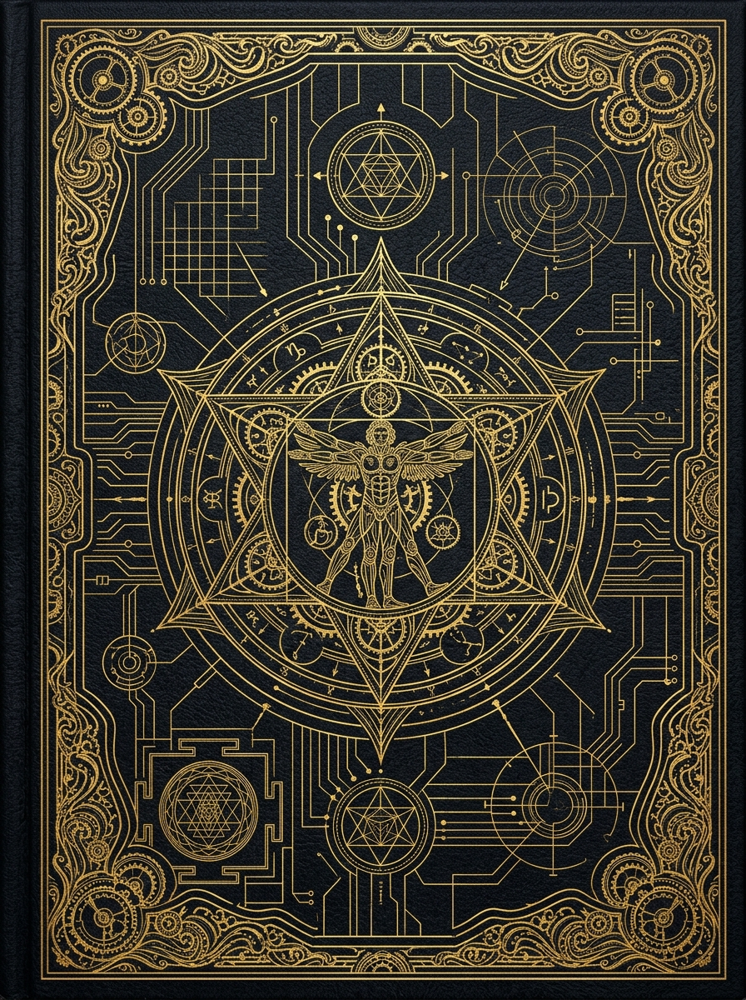

# ⚜️ CODEX CYBERNETICA // 3D Interactive Portfolio

> Интерактивный 3D-чертёжный кодекс и портфолио в стиле современного Леонардо да Винчи x Shopify Editions Winter '26.



## 🚀 Фичи проекта:
- 📖 **Реалистичная 3D-книга**: физика перелистывания страниц (библиотека `StPageFlip`), реалистичные тени, изгибы листов и управление за уголки.
- 🖥️ **Десктопный разворот**: честный режим на 2 страницы (открытая книга на рабочем столе).
- 📱 **Мобильная адаптивность**: автоматическое переключение в режим 1 страницы (Apple Books / Kindle) с поддержкой тач-свайпов.
- 🔖 **Закладки-ярлычки (Ribbon Index Tabs)**: быстрый переход по разделам (*Обложка, Манифест, Артефакты, Арсенал, Лаборатория, Контакты*).
- 🎧 **Синтезированный ASMR-звук шелеста страниц**: чистый Web Audio API без внешних аудиофайлов + тумблер Mute с эквалайзером.
- 🌌 **Кинематографичный фон**: чертежная координатная сетка, ambient spotlight, следующий за курсором, и парящие частицы.
- 🧪 **Интерактивная Астролябия Да Винчи**: кинетический 3D Canvas с гироскопом, реагирующий на курсор и клики (всплеск частиц).
- ⚡ **Интерактивный Видоискатель проектов**: переключение спецификаций и телеметрии в реальном времени.
- ✉️ **Сургучная печать Альянса (Wax Seal)**: тактильная анимация штампа с автокопированием email в буфер обмена.

## 🛠️ Стек технологий:
- **Core:** Чистый семантический HTML5, Vanilla JavaScript ES6+
- **Стилизация:** Модульный CSS3 с HSL-палитрой, кастомными переменными и glassmorphism
- **3D-книга:** `StPageFlip` (`page-flip.browser.js`)
- **Графика и интерактив:** HTML5 Canvas API (Астролябия и фон с частицами)
- **Звук:** Web Audio API (параметрический синтезатор шума и огибающих)

## 💻 Локальный запуск:
Любой статический сервер:
```bash
# Через Python:
python -m http.server 8877

# Или через Node.js:
npx serve .
```
Откройте в браузере: `http://localhost:8877/`
